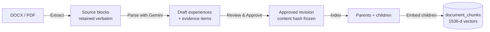
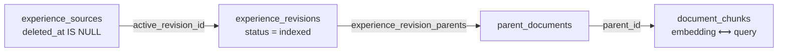
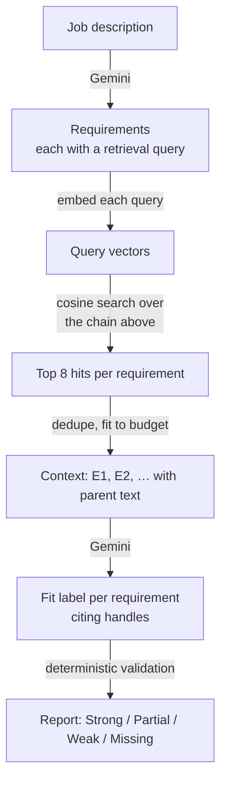

# JD Fit Check

A personal job-fit tool built on [Next.js](https://nextjs.org). You upload your own experience files (DOCX or selectable-text PDF), review the source-grounded draft the app extracts from each one, and approve and index it as evidence. You then paste a job description, and the app evaluates each of its requirements against that approved evidence, returning a categorical fit report in which every claim cites the source text it came from.

## Pages

The top bar has two destinations and a pill counting the indexed files.

- **Fit Check** (`/`). Paste a job description and choose "Evaluate fit". The report groups requirements as Strong, Partial, Weak or Missing and cites the exact sentence in your file for every claim. "Open in source" opens that sentence on the file's page.
- **Experience** (`/experience`). Upload a DOCX or selectable-text PDF in the "Upload experience file" drop zone. Each file then has its own page, `/experience/[id]`, that walks it through six stages: Upload, Extract, Parse, Review, Approve and Index. Indexing starts only when you choose "Index now". A collapsed "How it works" section on the list explains the stages.

## Environment

Create `.env.local` with:

```bash
NEXT_PUBLIC_SUPABASE_URL=your-supabase-url
SUPABASE_SERVICE_ROLE_KEY=your-supabase-service-role-key
GEMINI_API_KEY=your-google-ai-studio-key
```

`GOOGLE_API_KEY` also works if you prefer that variable name. The app uses `gemini-embedding-001` with `outputDimensionality: 1536`, so it can use the existing Supabase `embedding vector(1536)` schema.

`SUPABASE_SERVICE_ROLE_KEY` is required by the server API routes for experience ingestion, deletes, private storage access, and vector search. Keep it server-only; never prefix it with `NEXT_PUBLIC_`.

For more reliable PDF parsing, install Poppler and expose its `pdftotext` binary. If it is not on `PATH`, set:

```bash
PDFTOTEXT_PATH=/absolute/path/to/pdftotext
```

The app falls back to `pdf2json` when `pdftotext` is unavailable, but some PDFs with custom embedded fonts parse much more cleanly through Poppler.

Optional model overrides:

```bash
GEMINI_EMBEDDING_MODEL=gemini-embedding-001
GEMINI_GENERATION_MODEL=gemini-flash-lite-latest
```

## How the evidence index works

JD Fit Check is a retrieval-augmented pipeline with one unusual rule: the model never gets to invent evidence. Every passage it can cite is an exact, human-approved excerpt of a file you uploaded, and every citation points back to the character offsets that excerpt came from.

The pipeline has two halves. Indexing turns an uploaded file into searchable chunks. Evaluation turns a job description into a cited report. The tables involved fall into two groups: a **registry** that tracks each file through its stages, and the **evidence index** that search reads. One mapping table links them.

### Indexing: from file to vectors



1. **Upload.** The file goes into the private `experience-sources` storage bucket, and a row in `experience_sources` records its name, type, byte hash and storage path. This row is the file's identity for the rest of its life; its `status` column moves through the stages below, and its pointer columns (`latest_extraction_id`, `latest_draft_revision_id`, `latest_approved_revision_id`, `active_revision_id`) always say which version is which.

2. **Extract.** The file's text is split into ordered source blocks and saved as one `experience_extractions` row, with a text hash and parser version. These blocks are never modified; everything downstream refers to them by `{ block_id, start, end }`.

3. **Parse.** Gemini reads the blocks and proposes a structured draft: one or more *experiences* (a named project, or general experience such as role responsibilities), each with source-backed fields (title, role, technologies) and *evidence items* of kind `background`, `responsibility`, `contribution`, `challenge`, `decision` or `outcome`. The model must quote the source for every value. The app resolves each quote to exact offsets in a block and rejects anything that isn't a unique verbatim match. The result is saved as a `draft` row in `experience_revisions`, with the model and prompt version that produced it.

4. **Review.** Your edits update the same revision row's `draft_json`, bumping `draft_version` so two stale tabs can't overwrite each other.

5. **Approve.** The revision row gets its `approved_json`, a content hash and `approved_at`, and its status becomes `approved`. From here it is frozen: a later edit creates a *new* draft revision copied from this one, rather than changing it.

6. **Index.** The approved revision is planned into *parents* and *children*:
   - A **parent** is the full context of one experience: its referenced source spans, joined in document order and capped at 12,000 characters. Different experiences never share a parent.
   - A **child** is one evidence item's exact span, split at paragraph or sentence boundaries to about 1,200 characters. Its `child_text` is byte-for-byte the source text; this is what a citation will quote.
   - Each child also gets an `embedding_text`: short headers from source-backed fields, then the child text. Only the embedding text is vectorised, so retrieval benefits from context the raw quote lacks, while the quote itself stays pristine.

   ```
   embedding_text                              child_text (what gets cited)
   ──────────────────────────────────────      ──────────────────────────────────
   Project: Atlas                              Built TypeScript REST APIs for
   Role: Backend engineer                      billing, cutting p95 latency 40%.
   Technologies mentioned: TypeScript, Postgres
   Evidence kind: contribution

   Built TypeScript REST APIs for
   billing, cutting p95 latency 40%.
   ```

   Each `embedding_text` is embedded with `gemini-embedding-001` (task type `RETRIEVAL_DOCUMENT`, 1536 dimensions). Embeddings are prepared three at a time and checkpointed in `experience_index_staging`, so an interrupted index resumes rather than restarts. When every chunk is staged, one transaction publishes the result: it inserts the `parent_documents` and `document_chunks` rows, records which parents belong to this revision in `experience_revision_parents`, deletes the previous version's parents (their chunks cascade), points `experience_sources.active_revision_id` at the new revision, and clears the staging rows. If anything fails, the previous version stays live and searchable.

### What search can see

Search never looks at the registry's drafts or history. It follows one chain of pointers from each live file to its chunks, and only chunks reachable this way can be retrieved:



A draft, a superseded version, or a deleted file is simply not on the chain, so nothing from it can be cited.

### Evaluation: from job description to cited report



1. **Requirements.** A Gemini call extracts up to 20 distinct requirements from the pasted JD, each with an importance and a short retrieval query. The JD is passed as data, so instructions inside it (such as "rate this candidate 100%") have no effect.
2. **Retrieval.** Each retrieval query is embedded (`RETRIEVAL_QUERY`) and the `match_approved_experience_chunks` function ranks `document_chunks` by cosine similarity, restricted to the chain above. Up to eight hits are kept per requirement, four requirements searched at a time. Each hit comes back with its parent text and its lineage: file, revision, experience, evidence items and source span.
3. **Context.** Hits are deduplicated across requirements and fitted into a 16,000-character budget round-robin by rank, so every requirement keeps its best evidence before any keeps more. Each passage gets a handle (`E1`, `E2`, …).
4. **Report.** A second Gemini call labels each requirement `strong`, `partial`, `weak` or `missing` and cites handles. There is no numeric score.
5. **Validation.** Citations are checked mechanically. `strong` and `partial` need at least one valid handle or they become `missing`; unknown handles are dropped; a rationale may mention only handles it cites. One repair attempt is allowed, after which anything unsupported is downgraded rather than trusted. Display labels for each citation (experience title, type, evidence kinds) are read from the cited revision's `approved_json`, never from the model.

A citation resolves a handle to the file, revision, experience, evidence item and `{ block_id, start, end }` span, and its `quote` is the chunk's `child_text`. "Open in source" uses that span to highlight the sentence in the file.

### Table reference

| Table | Group | One row per | Holds |
| --- | --- | --- | --- |
| `experience_sources` | Registry | uploaded file | File identity, storage path, current `status`, and pointers to the latest extraction, draft, approved and active revisions. Soft-deleted via `deleted_at`. |
| `experience_extractions` | Registry | extraction of a file | The retained source blocks (`blocks`), text hash, parser version and warnings. Immutable. |
| `experience_revisions` | Registry | version of a file's structured content | `draft_json` while editing; `approved_json`, content hash and `approved_at` once approved; model and prompt provenance; status `draft` → `approved` → `indexing` → `indexed` (or `failed`). |
| `experience_index_staging` | Registry (scratch) | chunk being indexed | Prepared parent/child payloads and the embedding, keyed by plan hash and embedding config so only compatible checkpoints are reused. Cleared on publish. |
| `experience_revision_parents` | Mapping | parent published for a revision | Links a revision to its `parent_documents` rows with the logical experience and parent IDs. This is the join search uses. |
| `parent_documents` | Evidence index | experience context | `parent_text` (the joined source spans), file name and type, and metadata with the spans' offsets. |
| `document_chunks` | Evidence index | citable passage | `child_text` (exact quote), `embedding_text`, the 1536-d `embedding` under a cosine HNSW index, `chunk_index`, and metadata with the source span and evidence IDs. Deleting the parent cascades. |

The original file bytes live in the private `experience-sources` storage bucket, not in a table. All seven tables have row-level security enabled with no browser policies; only the server, using the service-role key, can read or write them.

### Why it is built this way

- **Parent/child chunks** let a small, precise span be matched while the model still sees the surrounding experience.
- **Separate embedding and citation text** means headers improve recall without ever appearing in a quote.
- **Registry and index are separate tables** so a file can have a draft in progress while its previous approved version stays searchable, and so publishing a new version is one atomic swap.
- **The approval gate** means nothing unreviewed can be retrieved, and nothing retrieved can drift from what you approved.
- **Logical IDs** (experience, parent, chunk) stay stable across re-indexing, so citations keep resolving after a file is updated.

## Getting Started

### Supabase MCP

To let your agent or IDE inspect the database, connect it to the project-scoped,
read-only Supabase MCP server:

```
https://mcp.supabase.com/mcp?project_ref=lwljmmfcvmbnrfstltzj&read_only=true
```

Authenticate using the Supabase login flow when prompted, selecting the
organization that owns this project. Do not put the application's service-role
key in any MCP configuration, and never commit credentials.

Verify the connection by asking: "Use Supabase MCP to list this project's
tables." Remove `&read_only=true` only when you intentionally need write
access, such as applying migrations, and use a development project rather
than production.

See the [Supabase MCP documentation](https://supabase.com/docs/guides/getting-started/mcp).

### Database setup

Apply the SQL files in `supabase/migrations/` in filename order, using the
Supabase SQL editor or the MCP `apply_migration` tool with write access enabled
on a development project. Do not reapply migrations already recorded there.
Together they create the seven tables described above, the search and
publication functions, the private `experience-sources` bucket, and a cosine
HNSW index on `document_chunks`. pgvector may live in either `public` or
`extensions`.

Every table has RLS enabled with no browser policies, and every function is
granted only to `service_role`. Never call them from client components or
expose the service-role key.

`supabase/checks/` holds smoke checks you can run in the SQL editor or via MCP
`execute_sql`; each rolls back its own data. `supabase/rollback/evidence_index.sql`
drops the evidence model entirely; use it only after confirming no evidence
data needs preserving.

The retired generic document search left a `documents` table, a
`match_documents` function and a `documents` bucket on the remote project.
Nothing references them, they were created outside `supabase/migrations/`,
and they are kept only until a separate decommission drops them.

First, run the development server:

```bash
npm run dev
# or
yarn dev
# or
pnpm dev
# or
bun dev
```

Open [http://localhost:3000](http://localhost:3000) with your browser to see the result.

This project uses [`next/font`](https://nextjs.org/docs/app/building-your-application/optimizing/fonts) to load Nunito Sans (headings) and Source Sans 3 (body text) from Google Fonts.

See the [Next.js documentation](https://nextjs.org/docs) for framework details.

## Deploying

The app is hosted on Google Cloud Run in project `jd-fit-check` (`australia-southeast1`). Identity-Aware Proxy lets in only the owner's Google account, and every push to `main` that passes CI deploys automatically. One-time setup, IAP, rollback and secret rotation are in [docs/deploy.md](docs/deploy.md).

## Branches and CI

Work is organised around OpenSpec changes, and the git rules follow from that.

- **One branch per change, named after the change id.** Cut it from `main` before the proposal is committed:

  ```bash
  git switch -c <change-id> main
  ```

- **All three commits land on the branch**: `docs: propose <change-id>`, the implementation, and `chore: archive <change-id>` as the last commit. `main` therefore never holds an active change.
- **`main` is updated only through a pull request**, merged with "rebase and merge" once all required CI checks are green. The branch is deleted on merge, locally and on origin.
- **Parallel changes use one git worktree each**, outside the repository, with its own install and env file:

  ```bash
  git worktree add ../rag-worktrees/<change-id> -b <change-id> main
  cp .env.local ../rag-worktrees/<change-id>/.env.local
  (cd ../rag-worktrees/<change-id> && npm ci)
  ```

  Every worktree shares the same remote Supabase project, so only one in-flight change may touch `supabase/` at a time. A second worktree running the browser test needs its own port: `EXPERIENCE_PREVIEW_PORT=3034 npm run test:browser`.

CI runs on every pull request and on pushes to `main` ([ci.yml](.github/workflows/ci.yml)). Three jobs are required checks, and a fourth deploys `main`:

| Job | Runs |
| --- | --- |
| `checks` | `npm run test:experience`, `npm run test:jd-fit`, `npm run test:rag-eval`, `npm run eval:rag` (offline retrieval-quality eval), `openspec validate --all`, `npm run lint`, `npx tsc --noEmit`, `npm run build` |
| `browser` | `npx playwright install --with-deps chromium`, then `npm run test:browser` |
| `image` | `docker build` of the production image, then checks that `pdftotext` is present, that no secret or Supabase URL is baked in, and that the server answers |
| `deploy` | Only on `main`, after the three jobs pass and once the GCP repository variables exist: pushes the image and deploys it to Cloud Run ([docs/deploy.md](docs/deploy.md)) |

`npm run test:browser` builds the app, serves it on port 3033, drives the four indexing-conflict scenarios and the oversized-upload check in headless Chromium with every API call intercepted, and stops the server. It never reaches Supabase or Gemini, so CI uses placeholder values for the environment variables the build reads. The live RAG eval, corpus seeding and the SQL checks in `supabase/checks` need the real project and stay manual.

A new test file inside an existing suite's folder runs in CI automatically. A new suite or job needs a step in `ci.yml`, and a new job also needs adding to the required checks on `main`. Locally, install the browser once with `npx playwright install chromium`; if a server is left behind after an interrupted run, `lsof -i :3033` finds it.
